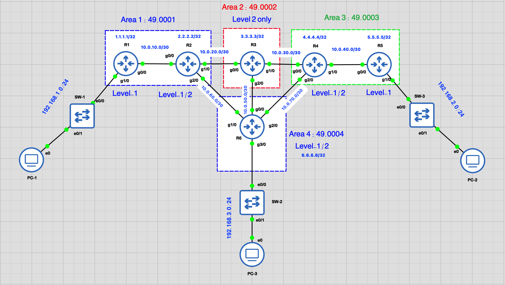

# Multi-Area IS-IS Routing Lab | GNS3

**A hands-on, six-router Cisco IS-IS lab exploring multi-area routing, Level 1/Level 2 adjacencies, SPF, ECMP, metric-based path selection, and redundancy.**

**Created by Khalid HARCHAOUI**



## Project overview

This educational GNS3 project implements **IS-IS (Intermediate System to Intermediate System)** across **six Cisco routers, four IS-IS areas, and three VPCS hosts**. Its backbone offers alternate paths for studying shortest-path calculations and forwarding behavior during topology changes.

The repository includes documented router configurations, the network diagram, a cleaned GNS3 project archive, and screenshots with an experiment report.

> **GNS3 image requirement:** The downloadable project deliberately **does not include Cisco IOS/IOU images**. Importing it requires suitable, legally obtained images and may require adjusting local image/template paths. Import and boot behavior has not been independently validated on a second machine.

## Lab objectives

- Understand the roles of IS-IS **Level 1**, **Level 2**, and **Level 1-2** routers.
- Build adjacencies within an area and across the Level 2 backbone.
- Examine the **link-state database (LSDB)** and **Shortest Path First (SPF)** results.
- Observe **Equal-Cost Multipath (ECMP)** when two paths have the same IS-IS metric.
- Change an interface metric to observe SPF route preference.
- Test connectivity and alternate-path behavior with **ping** and **traceroute**.

## Architecture

### Router roles

| Router | Area | IS-IS level | Loopback | Connections |
|---|---|---|---|---|
| **Khalid-R1** | `49.0001` | Level 1 | `1.1.1.1/32` | R2, PC-1 LAN |
| **Khalid-R2** | `49.0001` | Level 1-2 | `2.2.2.2/32` | R1 (L1), R3 (L2), R6 (L2) |
| **Khalid-R3** | `49.0002` | Level 2 only | `3.3.3.3/32` | R2, R4, R6 (L2) |
| **Khalid-R4** | `49.0003` | Level 1-2 | `4.4.4.4/32` | R3 (L2), R5 (L1), R6 (L2) |
| **Khalid-R5** | `49.0003` | Level 1 | `5.5.5.5/32` | R4, PC-3 LAN |
| **Khalid-R6** | `49.0004` | Level 1-2 | `6.6.6.6/32` | R2, R3, R4 (L2), PC-2 LAN |

R1–R2 and R4–R5 form **Level 1** adjacencies within their respective areas. R2, R3, R4, and R6 connect through **Level 2** links. The backbone has two alternatives between R2 and R4: **R2–R3–R4** and **R2–R6–R4**, with an additional R3–R6 link.

IS-IS process tags such as `KHALID-CORE`, `HARCHAOUI-CORE`, and `KHAKID-CORE-4` are **local identifiers** and do not need to match between routers.

### Inter-router addressing

All listed point-to-point router links use a **/30** subnet.

| Link | Subnet | Endpoint A | Endpoint B | Adjacency |
|---|---|---|---|---|
| R1–R2 | `10.0.10.0/30` | R1 `10.0.10.1` | R2 `10.0.10.2` | L1 |
| R2–R3 | `10.0.20.0/30` | R2 `10.0.20.1` | R3 `10.0.20.2` | L2 |
| R3–R4 | `10.0.30.0/30` | R3 `10.0.30.1` | R4 `10.0.30.2` | L2 |
| R4–R5 | `10.0.40.0/30` | R4 `10.0.40.1` | R5 `10.0.40.2` | L1 |
| R3–R6 | `10.0.50.0/30` | R3 `10.0.50.1` | R6 `10.0.50.2` | L2 |
| R2–R6 | `10.0.60.0/30` | R2 `10.0.60.1` | R6 `10.0.60.2` | L2 |
| R4–R6 | `10.0.70.0/30` | R4 `10.0.70.1` | R6 `10.0.70.2` | L2 |

### VPCS addressing

| Host | IP address | Default gateway | Attached router |
|---|---|---|---|
| PC-1 | `192.168.1.10/24` | `192.168.1.1` | R1 |
| PC-2 | `192.168.3.10/24` | `192.168.3.1` | R6 |
| PC-3 | `192.168.2.10/24` | `192.168.2.1` | R5 |

## Technologies and tools

- **GNS3** — network emulation and topology
- **Cisco IOS** — router configuration
- **IS-IS** — Level 1 and Level 2 routing
- **Wide metrics and SPF** — shortest-path calculation
- **ECMP** — equal-cost next-hop selection
- **VPCS, ICMP, and traceroute** — host connectivity testing

## Repository contents

| Path | Description |
|---|---|
| [`gns3-project/Multi-Area-IS-IS-Routing-GNS3-Lab-clean.gns3project`](gns3-project/Multi-Area-IS-IS-Routing-GNS3-Lab-clean.gns3project) | Cleaned GNS3 archive: topology and startup configurations; no IOS/IOU images |
| [`configs/`](configs/) | All six documented router configurations |
| [`documentation/Multi-Area-IS-IS-Routing-GNS3-Lab.png`](documentation/Multi-Area-IS-IS-Routing-GNS3-Lab.png) | Network-topology diagram |
| [`documentation/Multi_Area_ISIS_Full_Router_Configuration_Process_First.pdf`](documentation/Multi_Area_ISIS_Full_Router_Configuration_Process_First.pdf) | Router configuration walkthrough (PDF) |
| [`experiments/Results.md`](experiments/Results.md) | CLI observations, SPF/metric analysis, and failover notes |
| [`experiments/screenshots/`](experiments/screenshots/) | Verification screenshots and traceroutes |

**Router configurations:** [R1](configs/Khalid-R1.cfg) · [R2](configs/Khalid-R2.cfg) · [R3](configs/Khalid-R3.cfg) · [R4](configs/Khalid-R4.cfg) · [R5](configs/Khalid-R5.cfg) · [R6](configs/Khalid-R6.cfg)

## How to run the lab

1. Install **GNS3** and configure an appropriate emulation backend.
2. Download [the cleaned GNS3 project](gns3-project/Multi-Area-IS-IS-Routing-GNS3-Lab-clean.gns3project).
3. Import the archive using GNS3's project import function.
4. Provide your own **legally obtained, compatible Cisco IOS images**. The archive retains references to the original image filenames, so image selection or template adjustments may be necessary.
5. Verify interface mappings and startup configurations against [`configs/`](configs/), then start the devices.
6. Verify IS-IS neighbor relationships and test reachability between the VPCS hosts.

**Compatibility note:** The archive preserves **12 nodes and 13 links**, as reported by the archive preparation/validation step. It was checked for ZIP integrity and expected configuration files, but an actual import/run on another machine is still recommended.

### Quick verification commands

Run on Cisco routers:

```cisco
show isis neighbors
show isis database
show isis database detail
show isis topology
show ip route isis
show clns interface
```

Run from PC-1 in VPCS:

```text
ping 192.168.2.10
trace 192.168.2.10
```

## Experiments and observed results

Detailed evidence is available in **[experiments/Results.md](experiments/Results.md)**.

### 1. Level 1 and Level 2 adjacencies

The recorded neighbor output shows **R3 with three UP Level 2 neighbors: R2, R4, and R6**. R2–R1 and R4–R5 establish the Level 1 portions of the design.

[View R3 neighbor screenshot](experiments/screenshots/R3-ISIS-Level2-Neighbors.png) · [View R4 neighbor screenshot](experiments/screenshots/R4-ISIS-Level1-Level2-Neighbors.png)

### 2. SPF and equal-cost paths

Initially, the R2 Level 2 topology output reported **two equal-cost paths to R4**:

```text
R2 -> R3 -> R4    10 + 10 = 20
R2 -> R6 -> R4    10 + 10 = 20
```

This demonstrates two equal-cost **SPF next hops**. Per-packet traffic distribution depends on the installed forwarding behavior; the topology output alone does not prove that packets were evenly shared.

[View R2 SPF/routing screenshot](experiments/screenshots/R2-ISIS-Topology-and-Routing.png)

### 3. Metric optimization (temporary experiment)

To increase R2's outgoing Level 2 cost toward R6, the experiment applied:

```cisco
configure terminal
interface GigabitEthernet2/0
 isis metric 40 level-2
end
```

The subsequent R2 topology output showed R4 reached **via R3 at cost 20**. It also showed R6 reached **via R3 at cost 20**, rather than through the more costly direct interface.

> **Important:** The published base R2 configuration does **not** include `isis metric 40 level-2`. Apply this command separately when reproducing the metric experiment.

### 4. Connectivity and failover

The recorded PC-1 traceroutes demonstrate path selection through the backbone. When the R6 path was unavailable, traffic to PC-3 was observed through:

```text
PC-1 -> R1 -> R2 -> R3 -> R4 -> R5 -> PC-3
```

The repository also contains a screenshot labeled **after R3 failure**; consult the screenshot and verify live routing output before concluding its exact post-failure path.

[View PC-1 traceroute](experiments/screenshots/PC1-Traceroute.png) · [View traceroute after R3 failure](experiments/screenshots/PC1-Traceroute-After-R3-Failure.png)

## Key takeaways

- **Level 1** supports intra-area routing; **Level 2** connects the lab's IS-IS areas.
- The **LSDB** and **SPF topology** help explain which paths routers select.
- **Equal-cost alternatives** can produce multiple shortest-path next hops.
- A **higher interface metric** can change preferred routes, even toward a directly connected neighbor.
- **Redundant backbone links** provide alternative paths during failures, subject to successful routing convergence.

## Author

**Khalid HARCHAOUI**

A practical networking lab developed for learning, documentation, and hands-on routing verification.

---

*Educational use only. Cisco software images are not distributed in this repository.*
