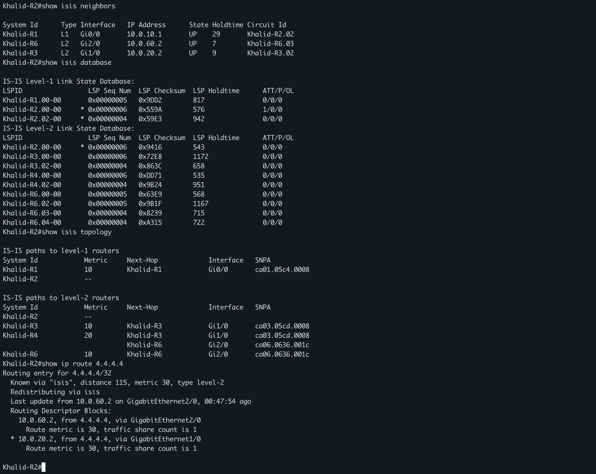
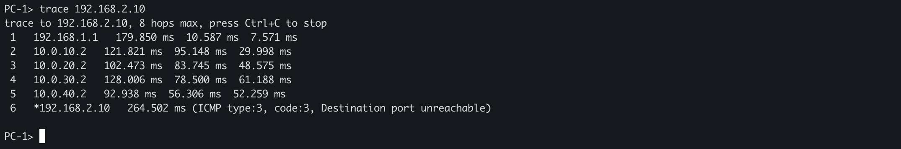
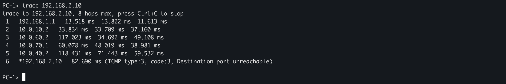

# Multi-Area IS-IS Lab — Experiment Results

**Project:** 6-router, 4-area IS-IS network in GNS3  
**Author:** Khalid HARCHAOUI  
**Environment:** Cisco IOS, GNS3, VPCS

> This report combines command outputs recorded during the lab with links to the screenshots uploaded to this repository. Screenshot filenames are reproduced exactly. Values listed below come from the recorded CLI outputs, not from automatic image transcription.

## 1. Lab architecture

| Router | Area | IS-IS role | Connections |
|---|---|---|---|
| Khalid-R1 | 49.0001 | Level 1 | R2; PC-1 LAN |
| Khalid-R2 | 49.0001 | Level 1-2 | R1 (L1), R3 (L2), R6 (L2) |
| Khalid-R3 | 49.0002 | Level 2 only | R2, R4, R6 (L2) |
| Khalid-R4 | 49.0003 | Level 1-2 | R3 (L2), R5 (L1), R6 (L2) |
| Khalid-R5 | 49.0003 | Level 1 | R4; PC-3 LAN |
| Khalid-R6 | 49.0004 | Level 1-2 | R2, R3, R4 (L2); PC-2 LAN |

**PC subnets:** PC-1: `192.168.1.0/24`; PC-2: `192.168.3.0/24`; PC-3: `192.168.2.0/24`.

The provider-style Level 2 backbone includes two primary alternatives between R2 and R4: **R2–R3–R4** and **R2–R6–R4**. R3 and R6 are also interconnected.

Topology image: [GNS3 lab topology](../documentation/Multi-Area-IS-IS-Routing-GNS3-Lab.png).

## 2. Neighbor adjacency verification

Run on participating routers:

```cisco
show isis neighbors
show clns interface
```

A recorded R3 neighbor table confirmed three **UP Level 2** adjacencies:

```text
System Id      Type Interface   IP Address      State
Khalid-R6      L2   Gi2/0       10.0.50.2       UP
Khalid-R4      L2   Gi1/0       10.0.30.2       UP
Khalid-R2      L2   Gi0/0       10.0.20.1       UP
```

**Interpretation:** R3 exchanges Level 2 IS-IS information with R2, R4, and R6. R2 also demonstrated an L1 adjacency to R1, and R4 an L1 adjacency to R5 during the lab.

### Router CLI screenshots




## 3. Link-state database (LSDB)

Run:

```cisco
show isis database
show isis database detail
```

A recorded R6 database contained its own Level 1 LSP and Level 2 LSPs originated by R2, R3, R4, and R6.

This demonstrates the separation of **L1** and **L2** LSDBs. Entries with identifiers such as `Khalid-R6.01-00` are pseudonode LSPs used on broadcast IS-IS networks; the suffix is not an area identifier.

The `*` marker identifies a locally originated LSP.

## 4. SPF and equal-cost multipath (ECMP)

Before metric optimization, R2 reported:

```text
IS-IS paths to level-2 routers
System Id     Metric  Next-Hop      Interface
Khalid-R3     10      Khalid-R3     Gi1/0
Khalid-R4     20      Khalid-R3     Gi1/0
                      Khalid-R6     Gi2/0
Khalid-R6     10      Khalid-R6     Gi2/0
```

Therefore, there were two equal-cost shortest paths from R2 to R4:

- `R2 -> R3 -> R4`: 10 + 10 = **20**
- `R2 -> R6 -> R4`: 10 + 10 = **20**

**Interpretation:** The IS-IS SPF topology table shows both equal-cost next hops. Individual forwarded packets may not alternate between both paths; actual load sharing depends on the installed forwarding entries.

## 5. Metric optimization — prefer R3

To raise the cost of the **R2 → R6** link:

```cisco
configure terminal
interface GigabitEthernet2/0
 isis metric 40 level-2
end
```

R2 then reported:

```text
IS-IS paths to level-2 routers
System Id     Metric  Next-Hop      Interface
Khalid-R3     10      Khalid-R3     Gi1/0
Khalid-R4     20      Khalid-R3     Gi1/0
Khalid-R6     20      Khalid-R3     Gi1/0
```

**Explanation:** The direct outgoing link toward R6 has cost 40, but R2 can reach R6 via R3 for 10 + 10 = **20**. Thus, `show isis topology` displays the **shortest calculated cost**, not every configured interface metric.

Check the configured interface metric using:

```cisco
show running-config interface GigabitEthernet2/0
show clns interface GigabitEthernet2/0
```

**Important:** The later `show running-config` capture supplied for R2 did **not** contain the `isis metric 40 level-2` line. Thus, metric 40 belongs to the *temporary experiment state*, rather than that saved base configuration.

## 6. End-to-end traceroute

For path validation, use VPCS:

```text
PC-1> ping 192.168.2.10
PC-1> trace 192.168.2.10
```



A recorded trace to R4's loopback showed a path through R6:

```text
PC-1> trace 4.4.4.4
1   192.168.1.1
2   10.0.10.2
3   10.0.60.2
4   10.0.70.1
```

This corresponds to `PC-1 -> R1 -> R2 -> R6 -> R4`.

## 7. Redundancy and failover

When the R6 path was unavailable during testing, a recorded traceroute reached PC-3 via R3:

```text
PC-1> trace 192.168.2.10
1   192.168.1.1
2   10.0.10.2
3   10.0.20.2
4   10.0.30.2
5   10.0.40.2
6   192.168.2.10
```

The observed logical route was:

**PC-1 → R1 → R2 → R3 → R4 → R5 → PC-3.**

The repository also contains a separately labeled screenshot for a test **after stopping R3**:



To verify the R3-failure test independently, compare the screenshot against these commands on R2 after the failure:

```cisco
show isis neighbors
show isis topology
show ip route 4.4.4.4
```

**Expected surviving backbone path if R6 remains available:** `R2 -> R6 -> R4`. The exact post-R3-failure hops and metric should be recorded from that test rather than assumed.

**Traceroute note:** VPCS can finish UDP traceroutes with `ICMP type 3, code 3` (destination port unreachable). When returned by the intended destination, this is a normal indication that the probe reached it.

## 8. Useful verification commands

```cisco
show isis neighbors
show isis database
show isis database detail
show isis topology
show ip route isis
show ip route 4.4.4.4
show clns interface GigabitEthernet2/0
show running-config interface GigabitEthernet2/0
```

## 9. Conclusions

The recorded tests demonstrate:

1. IS-IS Level 1 / Level 2 neighbor relationships across four areas.
2. Link-state database synchronization across the Level 2 backbone.
3. Equal-cost SPF paths from R2 to R4.
4. Metric-based preference for the R3 path.
5. Successful end-to-end forwarding through an alternate backbone path when R6 was unavailable.

The uploaded screenshots preserve additional evidence for presentation and review.

---

**Created by Khalid HARCHAOUI**
